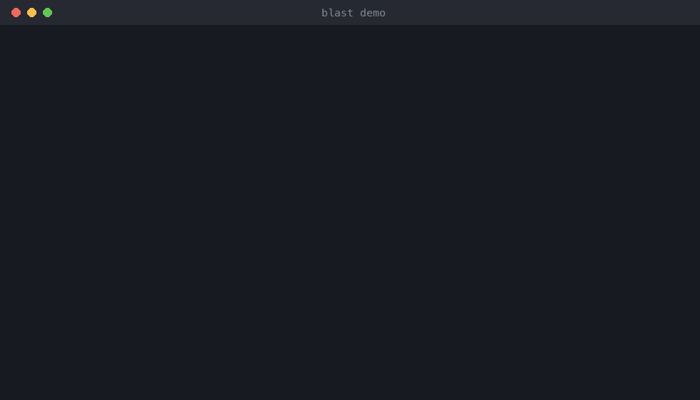

# impactci

Run only the Python tests your PR can actually affect.

## The problem

Most Python teams run the full test suite on every PR, even for a one-line change.
CI takes 20–40 minutes, people sit around waiting, and the CI bill keeps growing.

The existing options don't fit small and mid-size teams very well:

- **pytest-testmon** needs coverage data saved from earlier runs, which is awkward in fresh CI containers.
- **Bazel** means rewriting your whole build.
- **Launchable** is paid.

## The solution

**blast** is a zero-setup GitHub Action. It reads the PR diff, statically maps which
modules and tests the change can actually reach, runs only those tests, and comments
the blast radius on the PR.

- **stateless:** no coverage database, nothing to cache between runs
- **one step of YAML**
- **conservative:** when it's unsure it runs more tests, never fewer



## Results

Each repo's recent history was replayed commit by commit (`bench/replay.py`). For every
commit, a bug was planted in each function the commit touched, and the full suite was
run to see which tests catch it. A test the selector skipped that would have caught the
bug is a **miss**. Missed tests are rerun on their own first, so failures caused by other
tests leaving state behind aren't counted.

testmon got its best case: a coverage database from a full run of the parent commit.
In a fresh CI container it has no database and runs everything.

| repo | commits | blast: tests run | blast: misses | testmon (warm db): tests run | testmon: misses |
|---|---|---|---|---|---|
| [starlette](bench/results/starlette.md) | 30 | 54% | **0** / 25 | 24% | 1 / 25 |
| [packaging](bench/results/packaging.md) | 20 | 61% | **0** / 10 | n/a¹ | n/a¹ |
| [flask](bench/results/flask.md) | 30 | 92% | **0** / 6 | 60% | 0 / 6 |
| [requests](bench/results/requests.md) | 6 | 100% (79% with `--shallow-init`) | **0** / 5 | 35% | 0 / 5 |

¹ testmon crashes on packaging's pytest config, and packaging is one of pytest's own
dependencies, so the comparison isn't fair to it ([details](bench/results/packaging.md)).

[Django](bench/results/django-static.md) (selection only, 100 commits, ~2,900 files):
1.4s median analysis time. The median commit still selects 99% of test files, because
every Django test imports `django.test`, which loads most of the framework.

**What this means:**

- **Zero misses** across 46 commits with planted bugs that the full suite caught.
  That's the property that matters before trusting it to skip anything.
- **Big savings on app-shaped code.** When Starlette doesn't need a full run, blast
  picks 1–15% of tests. Packaging is under 10% on most targeted commits.
- **Little to gain on libraries whose package imports everything.** Every Flask test
  does `import flask`, and Flask's `__init__.py` pulls in nearly the whole package, so
  nearly everything is reachable. `--shallow-init` helps when tests import submodules
  directly (Requests drops to 79% of tests), not when they import the top-level
  package (Flask). On Requests it saved no time, though: the slow network tests
  live in the file every change reaches.
- testmon selects fewer tests when its database is warm, but it needs that state
  carried between CI runs, and it still had a real miss (a trio-parametrized test).

Real-world numbers come from shadow mode on the repos trying it
([how to try it](docs/trying-it.md)). `bench/collect.py` adds them up.

## GitHub Action

```yaml
on: pull_request

permissions:
  contents: read
  pull-requests: write   # for the comment

jobs:
  test:
    runs-on: ubuntu-latest
    steps:
      - uses: actions/checkout@v4
        with:
          fetch-depth: 0
      - uses: actions/setup-python@v5
        with:
          python-version: "3.12"
      - run: pip install -e . pytest
      - uses: jessi-sidhu/impactci@v0
        with:
          run: python -m pytest
```

The action diffs the PR against its base, posts (and keeps updating) one comment with
the blast radius, then runs your command on just the selected test files. It runs the
full command when blast decides it should, and skips it when nothing is affected.

| input | default | |
|---|---|---|
| `run` | | test command; selected files get appended |
| `path` | `.` | project root inside the repo |
| `base` | PR base | revision to diff against |
| `comment` | `true` | post the PR comment |
| `args` | | extra blast flags, e.g. `--shallow-init` |
| `shadow` | `false` | run everything, report what blast would have skipped |

Outputs: `mode` (`selected`/`full`), `tests`, `count`.

It downloads a prebuilt binary from this repo's releases when it can, and builds
from source (cached) otherwise. While the repo is private, other repos can only use it
if Actions access is granted in Settings → Actions → General → Access.

## CLI

```
cargo build --release

# which tests does this branch need?
./target/release/blast --diff main..HEAD path/to/repo

# machine readable
./target/release/blast --diff main..HEAD --json path/to/repo

# feed straight into pytest
pytest $(./target/release/blast --diff main..HEAD --format pytest-args)

# the PR comment
./target/release/blast --diff main..HEAD --format markdown

# why did this test get picked?
./target/release/blast why tests/test_views.py src/app/models.py

# debug: what does each module import?
./target/release/blast imports path/to/repo
```

`--diff` always compares against the merge base, same as a GitHub PR.

With `--format pytest-args`, a full run prints nothing (so bare `pytest` runs
everything). If no tests are affected it also prints nothing and says so on stderr,
so check for that before calling pytest if you want to skip the run.

## How it decides

1. Parse every `.py` file with tree-sitter and resolve imports (absolute, relative,
   `src/` layout, namespace subpackages). Importing `a.b.c` also counts as importing
   `a` and `a.b`, since their `__init__.py` runs.
   Imports under `if TYPE_CHECKING:` are skipped, they never run.
2. Strings that name one of your modules (`pytest_plugins`, `"pkg.mod:obj"`,
   `import_module("pkg.mod")`) count as imports too.
3. Walk the graph backwards from the changed files. A test is selected if it, or any
   `conftest.py` above it, can reach a changed module.

It runs the **full suite** when:

- a `conftest.py` changes
- build/test config changes (`pyproject.toml`, `setup.cfg`, `tox.ini`, `requirements*.txt`, CI workflows, ...)
- a non-Python file changes that isn't obviously docs (templates, json fixtures, ...)
- a top-level module is deleted
- every test ends up selected anyway

It also **adds** tests when a module they reach does something it can't follow:
`import_module(name)` with a variable, or an import that looks internal but doesn't
resolve. `--trust-dynamic` turns off the first one. `import_module("x")` with a literal,
or inside `for x in ("a", "b"):`, is followed like a normal import.

`--shallow-init` is for libraries whose `__init__.py` re-exports everything. Normally
`from pkg.utils import x` depends on all of `pkg/__init__.py`'s imports, because Python
runs that file first. With the flag, only the `__init__.py` file itself counts. It can
miss a change that breaks things at import time, so it's opt in.

## Benchmarks

```
# replay history with planted bugs (needs the repo's test deps in --python)
python3 bench/replay.py --repo ../starlette --python ../venv/bin/python -n 30 --testmon

# selection-only, for suites that don't run under pytest
python3 bench/static.py --repo ../django -n 100 -- --python-files tests.py --python-files 'test_*.py'

# add up shadow-mode runs from real repos
python3 bench/collect.py you/repo1 you/repo2
```

## Roadmap

- [x] week 1: parser (tree-sitter import resolution), tested on Flask and Requests
- [x] week 2: dependency graph + `blast --diff main..HEAD`, JSON output
- [x] week 3: test selection + safety fallbacks (dynamic imports, conftest, config changes)
- [x] week 4: replay repo history, compare against testmon and full runs
- [x] week 5: GitHub Action, PR comment with risk scoring, prebuilt releases, shadow mode
- [x] week 6: demo, Django benchmark, README
- [ ] real numbers from 2–3 repos running shadow mode
